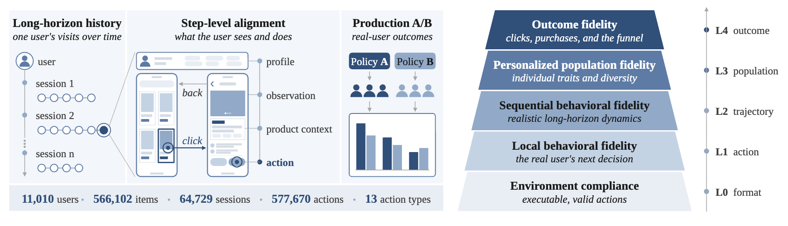
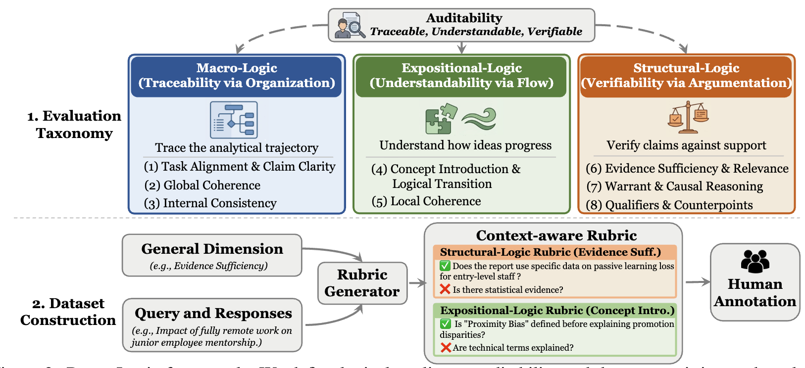
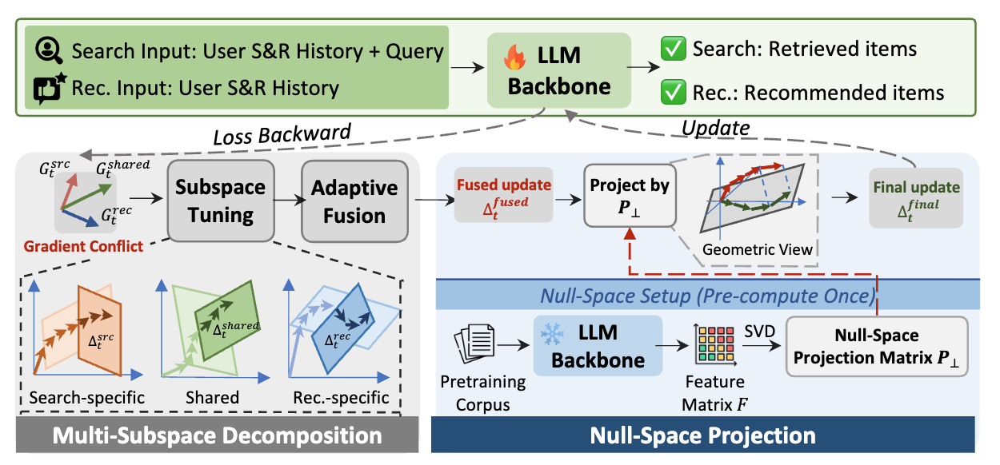
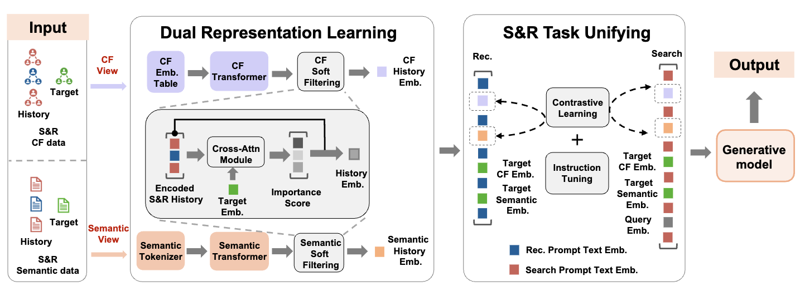

<header class="hero" id="about">
<h1>Jujia Zhao</h1>
Ph.D. candidate at Leiden University

I am a Ph.D. candidate at the <a href="https://www.universiteitleiden.nl/en/science/computer-science">Leiden Institute of Advanced Computer Science (LIACS)</a>, supervised by <a href="https://renzhaochun.github.io/">Zhaochun Ren</a> and <a href="https://liacs.leidenuniv.nl/~verbernes/">Suzan Verberne</a>. Previously, I received my master's degree from the National University of Singapore, where I was supervised by <a href="https://www.chuatatseng.com/">Tat-Seng Chua</a> and <a href="https://wenjiewwj.github.io/">Wenjie Wang</a> at the NExT++ Research Center.

My research focuses on generative and agentic recommendation, as well as LLM evaluation for open-ended tasks.

<a href="https://scholar.google.com/citations?user=h88M7FIAAAAJ">Google Scholar ↗</a><a href="https://github.com/Polaris-JZ">GitHub ↗</a><a href="mailto:zhao.jujia.0913@gmail.com">Email</a>

</header>

<section id="research">
01<h2>Research</h2>

<article><h3>Generative Recommendation</h3>
Unifying search and recommendation, cross-task knowledge transfer, and personalized adaptation.
<a href="#pub-gems">GEMS</a> · <a href="#pub-gensr">GenSR</a> · <a href="#pub-fellrec">FELLRec</a></article><article><h3>Agentic Recommendation</h3>
User modeling and simulation, conversational recommendation, and adaptive intent elicitation.
<a href="#pub-userarena">UserArena</a> · <a href="#pub-mmk">MMK</a></article><article><h3>LLM Evaluation for Open-Ended Tasks</h3>
Context-aware rubrics and reliable evaluators under ambiguous ground truth, including long-form report assessment and user intent evaluation.
<a href="#pub-reportlogic">ReportLogic</a></article>
</section>
<section id="featured">
02<h2>Featured research</h2>

<article class="feature">Preprint<h3><a href="#pub-userarena">UserArena</a></h3>
Modeling realistic shopping behavior

A benchmark and on-policy trajectory distillation method for long-horizon user simulation.

<a href="https://arxiv.org/abs/2610.30932">Paper ↗</a><a href="https://github.com/RecGPT-Team/UserArena">Code ↗</a>
</article><article class="feature">ACL 2026<h3><a href="#pub-reportlogic">ReportLogic</a></h3>
Evaluating complex generated reports

Fine-grained, context-aware assessment of logical quality in Deep Research reports.

<a href="https://arxiv.org/abs/2602.18446">Paper ↗</a><a href="https://github.com/Polaris-JZ/ReportLogic">Code ↗</a>
</article><article class="feature">SIGIR 2026<h3><a href="#pub-gems">GEMS</a></h3>
Learning across search and recommendation

Gradient multi-subspace tuning separates shared and task-specific optimization signals.

<a href="https://arxiv.org/abs/2601.09496">Paper ↗</a><a href="https://github.com/Polaris-JZ/GEMS">Code ↗</a>
</article><article class="feature">TOIS 2026<h3><a href="#pub-gensr">GenSR</a></h3>
A unified generative paradigm

Dual-view representation learning connects search intent and recommendation preferences.

<a href="https://arxiv.org/abs/2504.06714">Paper ↗</a><a href="https://github.com/Polaris-JZ/GenSR">Code ↗</a>
</article>
</section>
<section id="publications">
03<h2>Selected publications</h2>

<button type="button" aria-pressed="true" data-filter="all">All</button><button type="button" aria-pressed="false" data-filter="Generative recommendation">Generative recommendation</button><button type="button" aria-pressed="false" data-filter="Agentic recommendation">Agentic recommendation</button><button type="button" aria-pressed="false" data-filter="LLM evaluation">LLM evaluation</button><button type="button" aria-pressed="false" data-filter="Recommendation foundations">Recommendation foundations</button>

<article class="publication" id="pub-gems" data-topic="Generative recommendation">
SIGIR 2026

<h3><a href="https://arxiv.org/abs/2601.09496">Unifying Search and Recommendation in LLMs via Gradient Multi-Subspace Tuning</a></h3>
<strong>Jujia Zhao</strong>, Zihan Wang, Shuaiqun Pan, Suzan Verberne, and Zhaochun Ren

<a href="https://arxiv.org/abs/2601.09496">Paper ↗</a><a href="https://github.com/Polaris-JZ/GEMS">Code ↗</a>

</article>
<article class="publication" id="pub-gensr" data-topic="Generative recommendation">
TOIS 2026

<h3><a href="https://arxiv.org/abs/2504.06714">Unifying Search and Recommendation with Dual-View Representation Learning in a Generative Paradigm</a></h3>
<strong>Jujia Zhao</strong>, Wenjie Wang, Chen Xu, Xiuying Chen, Zhaochun Ren, and Suzan Verberne

<a href="https://arxiv.org/abs/2504.06714">Paper ↗</a><a href="https://github.com/Polaris-JZ/GenSR">Code ↗</a>

</article>
<article class="publication" id="pub-cold-start" data-topic="Generative recommendation">
SIGIR-AP 2026

<h3><a href="https://arxiv.org/abs/2603.29845">A Reproducibility Study of Cold-Start Recommendation in Generative Recommenders</a></h3>
Zhen Zhang*, <strong>Jujia Zhao</strong>*, Xinyu Ma, Xin Xin, Maarten de Rijke, and Zhaochun Ren

<a href="https://arxiv.org/abs/2603.29845">Paper ↗</a><a href="https://github.com/zhangzhen-research/ColdGenrec">Code ↗</a>

</article>
<article class="publication" id="pub-reportlogic" data-topic="LLM evaluation">
ACL 2026

<h3><a href="https://arxiv.org/abs/2602.18446">ReportLogic: Evaluating Logical Quality in Deep Research Reports</a></h3>
<strong>Jujia Zhao</strong>, Zhaoxin Huan, Zihan Wang, Xiaolu Zhang, Jun Zhou, Suzan Verberne, and Zhaochun Ren

<a href="https://arxiv.org/abs/2602.18446">Paper ↗</a><a href="https://github.com/Polaris-JZ/ReportLogic">Code ↗</a>

</article>
<article class="publication" id="pub-mmk" data-topic="Agentic recommendation">
RecSys 2025

<h3><a href="https://dl.acm.org/doi/10.1145/3705328.3748152">Model Meets Knowledge: Analyzing Knowledge Types for Conversational Recommender Systems</a></h3>
<strong>Jujia Zhao</strong>, Yumeng Wang, Zhaochun Ren, and Suzan Verberne

<a href="https://dl.acm.org/doi/10.1145/3705328.3748152">Paper ↗</a><a href="https://github.com/Polaris-JZ/CRS">Code ↗</a>

</article>
<article class="publication" id="pub-fellrec" data-topic="Generative recommendation">
Findings of NAACL 2025

<h3><a href="https://arxiv.org/abs/2402.09959">A Federated Framework for LLM-based Recommendation</a></h3>
<strong>Jujia Zhao</strong>, Wenjie Wang, Chen Xu, See-Kiong Ng, and Tat-Seng Chua

<a href="https://arxiv.org/abs/2402.09959">Paper ↗</a><a href="https://github.com/Polaris-JZ/FELLRec">Code ↗</a>

</article>
<article class="publication" id="pub-ddrm" data-topic="Recommendation foundations">
SIGIR 2024

<h3><a href="https://arxiv.org/abs/2401.06982">Denoising Diffusion Recommender Model</a></h3>
<strong>Jujia Zhao</strong>, Wenjie Wang, Yiyan Xu, Teng Sun, Fuli Feng, and Tat-Seng Chua

<a href="https://arxiv.org/abs/2401.06982">Paper ↗</a><a href="https://github.com/Polaris-JZ/DDRM">Code ↗</a>

</article>
<article class="publication" id="pub-pdro" data-topic="Recommendation foundations">
CIKM 2023

<h3><a href="https://dl.acm.org/doi/abs/10.1145/3583780.3615492">Popularity-aware Distributionally Robust Optimization for Recommendation System</a></h3>
<strong>Jujia Zhao</strong>, Wenjie Wang, Xinyu Lin, Leigang Qu, Jizhi Zhang, and Tat-Seng Chua

<a href="https://dl.acm.org/doi/abs/10.1145/3583780.3615492">Paper ↗</a><a href="https://github.com/Polaris-JZ/PDRO">Code ↗</a>

</article>
<article class="publication" id="pub-userarena" data-topic="Agentic recommendation">
Preprint

<h3><a href="https://arxiv.org/abs/2610.30932">UserArena: Benchmarking Interactive User Simulation for Long-Horizon Shopping Agents</a></h3>
<strong>Jujia Zhao</strong>, Jiakai Tang, Jing Yu, Wen Chen, Jian Wu, Han Zhu, Fei Sun, Suzan Verberne, and Zhaochun Ren

<a href="https://arxiv.org/abs/2610.30932">Paper ↗</a><a href="https://github.com/RecGPT-Team/UserArena">Code ↗</a>

</article>

* Equal contribution.
</section>
<section id="experience">
04<h2>Industry experience</h2>
<article class="experience">
<h3>Alibaba Group T-Star Talent Program</h3>
Research Intern · Taobao &amp; Tmall Group

<time>Sep 2026 – Present</time></article><article class="experience">
<h3>Ant Group</h3>
Research Intern · Ling Foundation Model Team

<time>Jul – Dec 2025</time></article></section>

<section id="education">
05<h2>Education</h2>
<article class="education">
<h3>Leiden University</h3>
Ph.D. in Computer Science

<time>Jul 2024 – Present</time></article><article class="education">
<h3>National University of Singapore</h3>
M.Sc. in Industry 4.0 · NExT++ Research Center

<time>Aug 2022 – Jun 2024</time></article><article class="education">
<h3>Beijing Institute of Technology</h3>
B.Eng. in Automation

<time>Aug 2018 – Jun 2022</time></article></section>
<section id="service">
06<h2>Academic service</h2>

<strong>Area Chair:</strong> ACL Rolling Review (2026).

<strong>Journal reviewer:</strong> TOIS, TKDE, TIST, TORS.

<strong>Program committee:</strong> KDD ’24, SIGIR ’25, WWW ’26, SIGIR ’26, WSDM ’27, ICLR ’27, WWW ’27.
</section>
